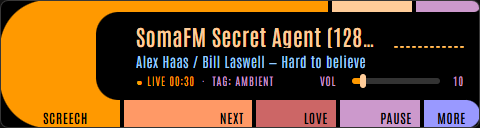
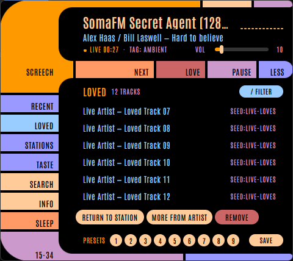

# SCREECH

A terminal radio that learns what you like. Point it at the world's internet
radio stations, press one key when you want something else, another when you
love what's playing. It figures out the rest. No accounts, no cloud, no
playlists, no telemetry. One binary, one config file, one database, all yours.

```
  SCREECH  PERSONAL RADIO                            ● LIVE  AAC · 128K · 2:14:06
  ▔▔▔▔▔▔▔▔▔▔▔▔▔▔▔▔▔▔▔▔▔▔▔▔▔▔▔▔▔▔▔▔▔▔▔▔▔▔▔▔▔▔▔▔▔▔▔▔▔▔▔▔▔▔▔▔▔▔▔▔▔▔▔▔▔▔▔▔▔▔▔▔▔▔▔▔

  ╭── RECEIVER / NOW PLAYING ──────────────────────────────────────────────────╮
  │ TRACK                              SIGNAL                                  │
  │ Billions and Billions              ▂ ▄ ▆ █ ▇ ▅ ▃ ▂  ▂ ▅ ▇ ▆ ▄ ▃           │
  │ Stellardrone                       ▁ ▂ ▄ ▆ ▅ ▃ ▂ ▁  ▁ ▃ ▆ ▅ ▃ ▂           │
  │                                    LOW                                HIGH │
  │ BROADCAST                          STATION MEMORY                          │
  │ SPACE STATION SOMA                 ───┴────────╂────────────┴───────────── │
  │                                    PRESET 7 · SAVED                       │
  │ WHY THIS STATION  Plays 3 artists you love                               │
  ╰────────────────────────────────────────────────────────────────────────────╯

  [SPACE] skip  [L] love  [F] preset 7  [P] pause  [/] discover  [H] library  [V] 75%  [?] help  [Q] quit
```

From 78 columns up (a standard 80×24 window included) Screech becomes a
receiver faceplate: the music owns the left bay, while the live signal and
station-memory dial occupy the right. The amber marker is the station
playing, the small ticks are saved presets, and the raised readout always
explains why the station was picked. Narrower or shorter windows collapse to
a compact stacked layout.

## Needs

- **mpv** on your PATH. It does all the audio heavy lifting: codecs, ICY
  metadata, reconnects.
  - Windows: `scoop bucket add extras` then `scoop install mpv`, or
    `choco install mpv`, or [mpv.io](https://mpv.io/installation/)
  - macOS: `brew install mpv`
  - Linux: `apt install mpv` (or dnf/pacman)
- A terminal with truecolor if you want the amber to glow. Windows Terminal,
  wezterm, kitty, and alacritty all qualify.

## Install

- Windows, with [Scoop](https://scoop.sh):
  `scoop install https://github.com/tinkthemaker/screech/releases/latest/download/screech.json`
  (this also adds `screech-gui` and a "Screech" Start-menu shortcut for
  [the window](#the-window-windows))
- Anywhere with Go 1.26 or newer:
  `go install github.com/tinkthemaker/screech/cmd/screech@latest`
- Or download the archive for Windows, macOS, or Linux from the
  [releases page](https://github.com/tinkthemaker/screech/releases) and put
  `screech` somewhere on your PATH. The Windows archives also carry
  `screech-gui.exe`.

From a checkout, `go run ./cmd/screech` runs it without installing.

## Run

```
screech                   start the radio (default)
screech doctor            read-only checkup of config, database, mpv, IPC, network
screech add <link>        add your own station: any http or https stream link
screech remove <link|id>  take one of your own stations back out
screech --version         print the version
screech --help            usage
screech --reduced-motion  calm the animations (or set SCREECH_REDUCED_MOTION=1)
```

Reduced motion turns off the boot sequence, the station-name scramble, the
tuning static, scrolling titles, blinking, the idle breathing, and the love
flash; the dial needle lands instead of springing. Nothing else changes.

Only one screech runs per data directory; a second launch says so and exits
without touching the first one's log.

First launch starts playing immediately from the built-in stations while the
radio-browser.info directory fills in behind it. If the directory is
unreachable, those stations (SomaFM, Radio Paradise, WFMU, KEXP, NTS, WWOZ)
keep Screech useful offline. Every later launch resumes where you left off,
zero presses.

The catalog stays alive on its own. Once a week (in the background, playback
never waits) screech re-pulls the top slice: new stations arrive, stations
the directory stopped vouching for get pruned unless you have history with
them, and stations that failed for you get a strike forgiven when the
directory says they're healthy again. Presets, loved stations, and anything
you've listened to are never pruned.

Something wrong? `screech doctor` checks each dependency in turn (config,
database, mpv, the IPC handshake, yt-dlp and its JavaScript runtime,
Bandcamp, the directory) and reports what it finds.
Every run also writes a log next to the config file, and startup errors hold
the window open instead of vanishing with the message.

## Your own stations

Got a stream the directory doesn't list? Add the link:

```
screech add https://example.com/stream.mp3 --name "Late Night Jazz" --tags "jazz, late night"
```

`--name` and `--tags` are optional; without a name the station is called
after its host. Screech writes the link into `config.toml` as a
`[[stations]]` table, and that file is the only place it lives. The database
just caches it, so a fresh database, or a fresh install with your old config
file, still has every link. You can write the table yourself, too:

```toml
[[stations]]
name = "Late Night Jazz"
url = "https://example.com/stream.mp3"
tags = "jazz, late night"   # optional, like codec, bitrate, country, homepage
```

Your stations join the rotation the next time Screech starts; a copy that's
already running carries on without them until then. They survive every
directory refresh, and a few of them are in the running on every pick, so
they come round now and then even without tags. Stay on one and the model
keeps it coming back; skip it and it fades like any other station. When one
is picked for being yours, the status line says `added by you`.
`screech doctor` counts them and warns about any entry it had to skip: a
missing name, a link that isn't http or https, a duplicate.

`screech remove <link>` (or the `custom:` id that `add` printed) takes one
back out. Its listening history stays, so adding the same link again picks
up where it left off.

A link is normally the stream itself: an Icecast or Shoutcast mount, an
`.mp3`, `.aac` or `.m3u8` URL, or a `.pls`/`.m3u` playlist. A YouTube video
link is the exception: `screech add` makes it a
[discovery station](#discovery-stations) seeded from that video.

**Page links, with yt-dlp (optional).** A YouTube, SoundCloud, Vimeo,
Mixcloud, Bandcamp or Twitch link is a web page, not a stream. Screech can
play one through [yt-dlp](https://github.com/yt-dlp/yt-dlp), and it finds
yt-dlp on its own: first on your PATH, then beside `screech.exe`, then in
its data folder. If yours lives somewhere else, point `ytdlp_path` at it in
`config.toml`, above any `[[stations]]` table. `""` (the default) means
find it, and `"off"` means never run it:

```toml
ytdlp_path = ""   # "" finds yt-dlp; a full path names it; "off" turns it off
```

Each time such a station is tuned, Screech asks yt-dlp for the audio
stream, giving it at most 6 seconds; a page that won't resolve is skipped
like a dead stream. The track line shows the artist and track yt-dlp
reports, or the video's title. `screech doctor` says where it found
yt-dlp, its version, and the JavaScript runtime it will use, and suggests
`yt-dlp -U` when the release is over 60 days old. Screech plays one stream
per page: a playlist link plays its first entry.

## Discovery stations

Type a genre, an artist or a song, or paste a YouTube link, and Screech
starts a discovery station: an endless mix that keeps finding new bands in
that sound, with a well-known track now and then. The songs come from
YouTube Music and Bandcamp, and the status line shows each one's real title.

Start one from **FIND**, the front door of the [window](#the-window-windows),
or with **`/`** in the terminal. FIND is a single bar: Enter starts a
station from what you typed. Under the bar, your most recent discovery
stations wait under "pick up where you left off", and a click, or the down
arrow then Enter, picks one up again. Tab in the terminal, or the RADIO tab in the
window, switches the bar to radio search instead.

The mix is discoveries and anchors. Discoveries are bands you probably
haven't heard, smaller and newer. Anchors are the genre's well-known tracks,
about one song in five; a run of quick skips brings more of them for a
while, and loving a discovery brings fewer. A song never comes round again
on the same station within its last 200 songs, and the same band never
plays twice in a row. Songs run from 90 seconds to 12 minutes, so mixes and
full albums are left out.

**NEW TO YOU** marks a band you've never heard or loved on Screech. Those
bands come first among the discoveries, and the status line shows the
label while one plays.

**NEXT** on a discovery station plays the next song. The station stays
where it is, and the skip isn't counted against it. Press NEXT again within
3 seconds and it changes station, as NEXT always has. The status line
suggests exactly that. **LOVE** loves the song, as it does on any station.

**yt-dlp, and a JavaScript runtime.** YouTube songs need
[yt-dlp](https://github.com/yt-dlp/yt-dlp), which Screech doesn't install or
update; `screech doctor` says when to run `yt-dlp -U`. Without yt-dlp, a
station plays from Bandcamp alone, and a YouTube link can't start one (the
status line says why). yt-dlp also wants a JavaScript runtime to get past
YouTube's challenges, and a runtime is recommended: deno, node or bun on
your PATH. Deno is used as it is; otherwise Screech hands yt-dlp node or
bun. Bandcamp's feed is undocumented and may change without notice. When it
stops answering, `screech doctor` says so, and stations lean on YouTube alone.

A discovery station started from FIND is kept as history. Pressing `f` on
one saves it as a preset, which keeps it for good. A station can also live
in `config.toml`, with `discover` in place of `url`; `screech add --discover`
writes one for you:

```toml
[[stations]]
name = "Dungeon synth"
discover = "dungeon synth"   # a phrase or a YouTube link, instead of url
```

## Controls

**space** (or `n`) — next station. This is also your skip button: hit it the
moment ads or talk start. Pressed fast (under 90 seconds) it counts against
the station; pressed after a long listen it's just a variety request, since
the listen already banked its credit. Skips during a suspected ad break are
discounted, so escaping ads never punishes a good station. When screech
suspects a break, the status line shows: `BREAK  SPACE skips without penalty`.

**l** — love the current track. Strong positive on the artist, the station,
and its tags. The loudest signal you can send; use it honestly. It's a
toggle: press again on the same track (or, with no parsed title, the same
station) to take the love back — screech returns exactly the boost it gave
and the heart goes out.

**f** — save the current station to a preset, or unsave it. Presets are pure
recall and never touch the taste model. Love teaches, presets remember.

**1–9** — jump straight back to a saved preset, deterministically. Saved
stations show as ticks on the dial line. Nine slots stay nine: they're
muscle memory, not a list. Everything past that lives in the library.

**v** — open Screech's volume slider. Left/right arrows or `-`/`+` adjust
the player in five-percent steps without changing system volume; `-`/`+`
(or `[`/`]`) also work straight from the main screen. The level is
remembered across launches. The slider tucks itself away after a few
seconds; `v`, enter, or esc closes it sooner, and any other key closes it
and does its usual job.

**p** — pause and resume. It's mpv's own pause underneath, so keyboard
media keys, headset buttons, and the Windows media flyout pause the same
radio, and screech notices (macOS media keys work through mpv too, and on
Linux the mpv-mpris plugin does the same job). A pause under 30 seconds
picks up from the buffer a few seconds behind live, like pausing live TV; a
longer one rejoins the broadcast where it is now. Pausing ends the listen,
so paused time neither teaches the model nor counts as listening. A media
Stop key pauses too; Next and Previous do nothing, since there's no
playlist to step through. Choosing any station (space, a preset, the
library) turns the radio back on.

**z** — sleep timer. Each press steps through 15, 30, 45, 60 and 90
minutes, then off, and the key strip counts it down. Over the last 30
seconds the sound fades out (your saved volume is untouched), then the
radio pauses itself.

**t** — open the theme picker. Move with arrows or `j`/`k` (or press a
digit) to preview a finish live, Enter applies and remembers it, and Escape
restores the previous theme. Receiver is the warm phosphor default and
Austere is strict monochrome; Verdant, Azure, Violet, and Slayer are the
same faceplate in other hues, and Charm and Lagoon carry a two-hue
gradient. Every finish tempers with the time of day.

**h** — recently heard tracks, newest first; `j`/`k` scroll. Loved tracks
carry an ember heart.

**H** — open the library, starting with loved tracks. `tab` moves through
recent tracks, loved tracks, saved stations, and a taste summary. In the
loved view, `/` searches across artist, title, and origin station; arrows
or `j`/`k` select;
`enter` asks screech for more from that artist; `r` returns to the station
that played it; and pressing `x` twice removes it.

The taste view is the library's mirror back at you: total and weekly
listening, which dayparts your hours land in, the artists you actually
hear (titles caught inside a skip under 90 seconds don't count), the tags
the taste model leans on, your most-listened stations of the month, and
your loved-track count.

The saved-stations view is the full two-tier station list: your presets
(their slot number sits in front of the name, like a channel) plus every
station you've loved a track on, most-listened first, unbounded. `/`
searches by name, `j`/`k` select, `enter` tunes, digits jump straight to a
preset, and pressing `x` twice removes the station from recall — clearing
its preset slot and its loves while leaving listen history and the taste
model alone. In both searchable views, esc clears the search before it
closes the library.

**/** — find something to play. The bar takes an artist, a song, a genre or
a YouTube link, and Enter starts a [discovery station](#discovery-stations)
from it. Your recent discovery stations sit under the bar, and the down
arrow then Enter picks one up. **Tab** switches the bar to radio search, which is what
`/` used to do: type a genre and screech tunes a matching station
instantly: a tag in the local cache plays immediately, and a tag the cache
doesn't carry (regional genres like "corridos" often aren't in the top-20k
global slice) is searched against the directory, cached, and tuned. Type an
artist and it pseudo-loves the name so fingerprints catch them as you
listen, tunes any station actually named for them, and — when none exists,
which is the common case — falls back to a small curated artist→genre map
so you still land in the right musical family. The reason line always says
which fired: `seeded: corridos` vs `seeded genre: corridos`. Typing
"artist - song" uses the artist half. Genre seeds deliberately echo through
the next four picks, then fall back to the ordinary decaying taste signal.

**i** — about this station: where it streams from, its tags and homepage,
how much of it you've heard and how many tracks you've loved there, and
whether it has strikes against it. `MATCH` is the picker's own current
estimate that you'll stay on it at this time of day.

**?** — every key on one page, grouped by what it does. Esc puts it away;
any other key closes it and still does its own job. The same goes for `i`.

**q** — quit.

## The window (Windows)



On Windows, Screech also comes as a small window in the LCARS style of a
starship control panel: something to leave open beside other work, glance
at, and click NEXT or LOVE on. It is the same Screech as the terminal with
another face on the same listening engine: the same library, loves,
presets, history, taste model and `config.toml` (`mpv_path`, `data_dir`,
`auto_hop_ads` and `sync_limit` apply; `accent`, `ascii` and the theme
picker are terminal-only, since the window has one palette). Pause, sleep,
reconnects, offline retries and mpv restarts follow the same rules, and
`--reduced-motion` or `SCREECH_REDUCED_MOTION=1` calms the window too.

Start it with `screech-gui.exe`, which sits next to `screech.exe` in the
Windows zip, or with the "Screech" Start-menu shortcut the Scoop package
adds. It needs mpv, like the terminal, and **WebView2**, Microsoft's web
view, which is built into Windows 10 and 11; if it's missing, the window
offers to install it. If startup fails (a config that isn't valid TOML, mpv
missing), a message box says why.

Only one Screech runs per data directory, window or terminal. Opening the
window a second time brings the first to the front. The terminal refuses to
start while the window is open, and the window says so if a terminal is
already playing.

The strip is 480 × 128: the station and a level meter, the track, then a
status row (`LIVE`, `TUNING`, `RECONNECTING`, `BUFFERING`, `PAUSED`, the
pick reason, feedback such as `LEARNED  Fast skip noted`) ending in the
volume slider, and the PAUSE, NEXT, LOVE and MORE buttons. A red ✕ in the
top-right corner closes Screech. Long station and track names scroll once so
you can read them in full. On a discovery station the track row shows the
song, and the status shows `NEW TO YOU` for a band you haven't heard on
Screech before. Offline turns the whole frame red and NEXT reads RETRY NOW.
**Volume is the slider, or `-`/`+` (`[`/`]`); the mouse wheel never changes
it**, so a stray scroll over a window sitting behind a game or a web page
can't. The ✕, `q`, Alt+F4 or the taskbar's Close quits Screech and stops the
radio. The window's outer corners
follow the LCARS curves. Drag it by its frame (the top bar and the left block).



**MORE** unfolds the strip downward into a 480 × 428 console, and LESS (or
`esc`) folds it back; nothing in the strip moves. Near the bottom of the
screen, the window moves up by exactly as much as it needs to fit and moves
back when you fold it, unless you dragged it in between. The tabs down the
left are **FIND** and **RADIO**, the terminal's views **RECENT**, **LOVED**,
**STATIONS** and **TASTE**, and **MORE**. MORE holds the station sheet (what
`i` shows in the terminal) and a **SLEEP** pill, which steps 15, 30, 45, 60
and 90 minutes and off like `z` and shows the minutes left. LOVED and
STATIONS have a `/ FILTER` pill. The
actions under a list are RETURN TO STATION, MORE FROM ARTIST and REMOVE on
LOVED, and TUNE and REMOVE on STATIONS; REMOVE asks for a second press
(it reads CONFIRM for three seconds), like `x` twice. The footer holds your
nine presets (saved ones tan, the one playing orange; click one to tune it)
and a SAVE pill that saves or frees the current station like `f`. The
elbow at the bottom left shows the local time.

**FIND** is where the console opens: one bar for starting a discovery
station. Type an artist, a song, a genre or a YouTube link and press Enter
or GO. The console folds, and the strip shows `TUNING` while the station
starts. Under the bar, up to four of your recent discovery stations wait
under PICK UP WHERE YOU LEFT OFF; a click, or the down arrow then Enter,
picks one up.
**RADIO** is the same bar in blue for radio search: Enter tunes the best
match, and your most-listened radio stations sit below it. Tab moves between
FIND and RADIO, and esc closes the console.

When the window has focus, the terminal's keys work:

| Key | Does |
|---|---|
| `space`, `n` | next station (RETRY NOW while offline) |
| `l` | love or unlove the track |
| `f` | save the station to a preset, or free it |
| `1`-`9` | jump to a preset |
| `p` | pause and resume |
| `z` | sleep timer |
| `-` `[` / `+` `=` `]` | volume down / up by 5 |
| `/` | open FIND and type; on LOVED or STATIONS, open the filter instead |
| `h`, `H` | unfold to RECENT, or to LOVED |
| `i` | unfold to MORE, the station sheet |
| `tab`, `shift+tab` | next or previous tab, while unfolded |
| `j` `k`, arrows, `pgup` `pgdn`, `home` `end` | move through the rows |
| `enter` | the row's main action: MORE FROM ARTIST on LOVED, TUNE on STATIONS; in FIND, start a discovery station; in RADIO, tune the best match |
| `r` | return to the station a loved track came from |
| `x` | remove the selected row (press twice) |
| `esc` | clear the filter or the search box first, then fold |
| `q` | quit |

Holding a key repeats only the volume and row keys, so a held `space`
skips one station. While the FIND, RADIO or filter box has focus, keys type
into it: `enter` submits and `esc` backs out. On a first launch, `space` in
an empty RADIO box tunes a wildcard.

## What it's doing underneath

Every station carries Beta(α, β) counts split by daypart (morning, day,
evening, night). Listening bumps α, capped so falling asleep to a stream
can't swamp anything. Fast skips bump β. Streams that fail never touch the
taste model — a dead stream isn't a bad station, it just gets a strike, and
three strikes benches it. When you press next, a Thompson sample from each
candidate picks the winner: uncertainty does the explore/exploit balancing
and there are no knobs to tune. Candidates come from five places: your tag
affinities, stations that play artists you love, stations your own
listening rates well, a few of the stations you added yourself, and a
random slice for serendipity. A
simulated-listener test (`go test -tags eval ./internal/core`) checks that
the picks actually get better as it learns.

Every track title that comes down the stream is parsed and logged (about a
third of stations never send usable titles — fingerprints are one signal,
never a gate). Stations that play artists you love surface through
rarity-weighted overlap: sharing an obscure artist means far more than
sharing a chart-topper. All counts decay with a roughly three-week
half-life, so your taste can drift and the model follows. The status line
always explains the pick: `plays 3 artists you love`, `tag: ambient`,
`seeded: jungle`, `added by you`, `wildcard`.

Ad avoidance is mostly curation. Commercial simulcast networks get downranked
before you ever hear them; college, community, and listener-supported streams
get upranked. Title-based break detection exists but stays humble: it flags
suspicion and discounts your skips. Set `auto_hop_ads = true` and screech
also moves on by itself, but only when a stream's title literally announces
the break ("advertisement", "commercial break"). Empty titles and titles
that just repeat the station name mark a suspected break, never a hop:
DJ talk and station IDs look the same. It hops at most once every 30
seconds, and a hop teaches the model exactly what skipping that break
yourself would.

The wave under the station name moves with the stream's real loudness,
measured by mpv and reported over the same pipe that carries titles. Texture
is synthetic; amplitude is true.

## When the signal drops

Internet radio drops constantly, and none of it should need you.

- A station that was playing and loses its stream (the server hangs up, or
  the buffer stalls for 20 seconds) is reconnected in place: same station,
  same listen, `RECONNECTING` in the header. Only a station that drops
  more than three times without a steady minute in between gets a strike
  and is left behind.
- A station that never locks (12 seconds of nothing, or an outright error)
  gets one strike and screech moves on. Three strikes benches it until a
  directory refresh vouches for it again.
- When three stations in a row fail, the problem is the network, not the
  stations: screech takes back the strikes it just handed out, shows
  `OFFLINE`, and retries on its own (5s, 10s, 20s… up to a minute),
  alternating between the last station that played and a fresh one.
  `SPACE` tries immediately. The first stream that locks clears it.
- If mpv itself crashes, screech restarts it and picks the station back up,
  up to three times in five minutes before it asks you to restart.
- If screech is killed outright, the mpv it started goes with it on Windows
  and Linux, instead of playing on with nothing to stop it.

## Config

`%AppData%\screech\config.toml` on Windows,
`~/Library/Application Support/screech/config.toml` on macOS, and
`~/.config/screech/config.toml` on Linux. First launch writes it with
commented defaults covering the accent color, ASCII fallback, mpv path, data
directory, ad hopping, directory cache size (`sync_limit`, at most
50,000), where to find yt-dlp (`ytdlp_path`), and examples of
[your own stations](#your-own-stations) and
[discovery stations](#discovery-stations). Keep settings above
the first `[[stations]]` table: in TOML, anything below one belongs to it.
`data_dir` accepts `~` and paths relative to the config file.

A typo never stops the radio: unknown keys, a malformed accent, an
out-of-range `sync_limit`, or a `[[stations]]` entry that can't be played
are repaired or ignored, and each one is listed in the log and by
`screech doctor`. A config that isn't valid TOML is the one thing that does
stop startup, with the line number.

The theme picker and volume are remembered in the local SQLite file.
Everything Screech learns lives there too.

## Your data

Everything stays on your machine: `config.toml`, `screech.db` (stations,
listens, loved tracks, the taste model), and `screech.log` (the last run
only). The network traffic is the streams you listen to and the
radio-browser.info directory: the weekly catalog refresh, radio searches,
and the click report their etiquette asks for when a station starts.
Discovery stations also reach YouTube, through yt-dlp, and Bandcamp's
discover feed. Their song links are never stored. Nothing else, and no
telemetry.

Your data is yours to take with you, without stopping the radio:

```
screech export loved          loved tracks as CSV, newest first
screech export heard          every heard title as CSV, newest first
screech export backup out.db  a consistent copy of the whole database
```

Both CSVs write to stdout; cells that would run as spreadsheet formulas
are quote-guarded. The backup refuses to overwrite an existing file.

To start over, quit and delete the data directory. If the database is ever
damaged, screech moves it aside as `screech.db.corrupt.<timestamp>`, starts
fresh, and says so on the status line until you press a key.

Station names and track titles come from strangers' servers, so screech
strips terminal control sequences and layout-breaking characters before it
displays or stores them.

## Building

The commands below select Go 1.26.10, which includes the certificate
verification security fix. Go downloads that toolchain if needed.

```
GOTOOLCHAIN=go1.26.10 go build -o dist/screech ./cmd/screech
```

The window needs its build tags. Without them, Windows builds only Wails'
stub, which shows an error box instead of a window (other platforms skip
the window entirely), so a plain `go build ./...` still works everywhere:

```
GOTOOLCHAIN=go1.26.10 CGO_ENABLED=0 GOOS=windows go build -tags desktop,production -trimpath -ldflags "-s -w -H windowsgui" -o dist/screech-gui.exe ./cmd/screech-gui
```

Tagged releases are built for Windows, macOS, and Linux by the release
workflow. SQLite is pure Go, so cross-compilation does not require CGO, and
neither does the window.

## Troubleshooting

Run `screech doctor` for dependency, database, IPC, and network checks. It
changes nothing on disk (the mpv handshake runs in a throwaway temp
directory), reports files a fresh install hasn't created yet as `--` rather
than failures, and exits with a bitmask of what failed: 1 config, 2
database, 4 mpv, 8 IPC, 16 network, 32 yt-dlp, 64 Bandcamp.

Set `ascii = true` if terminal glyphs render poorly; everything on screen is
then plain 7-bit text. Small windows are fine: the layout sheds detail step
by step, down to a few columns, rather than refusing to start. The header
keeps the playback state (`LIVE`, `OFFLINE`, `BUFFERING`) to the last, and
the key strip drops its quieter labels before the keys themselves.
The last-run log lives next to the config file.

## Design

[SPEC.md](SPEC.md) holds the full interaction, algorithm, and visual design.
